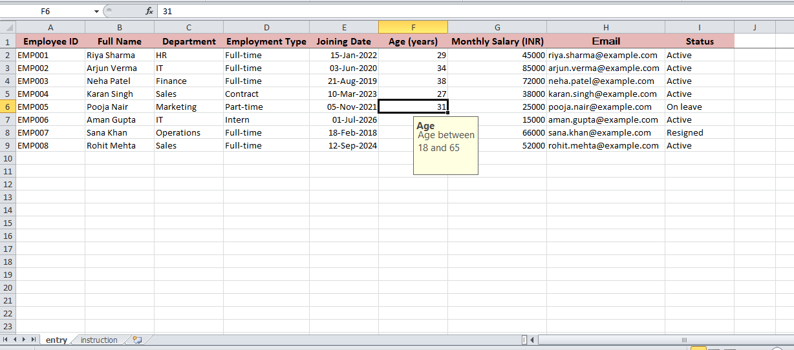
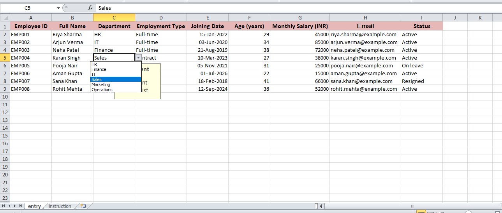
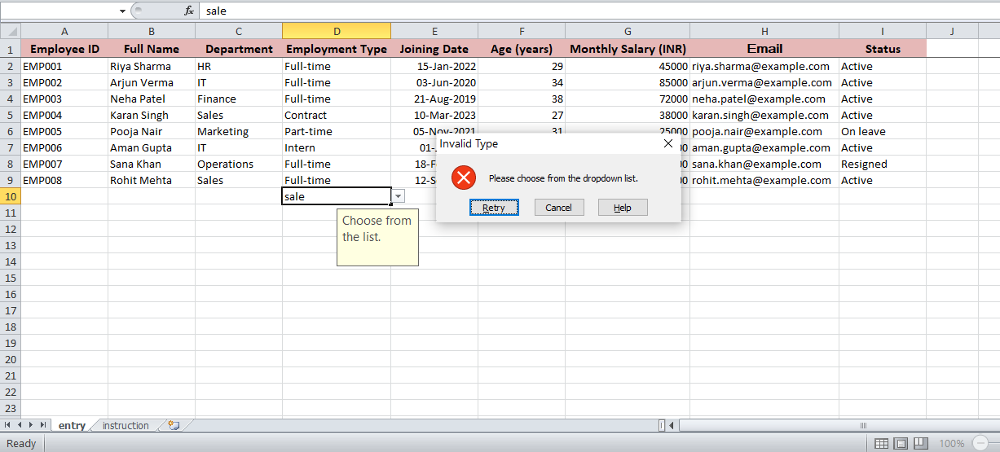

# Basic Data Validation (Excel Data-Entry Template)

## Overview
An Excel data-entry sheet for employee records that uses dropdowns and validation rules to
stop invalid entries. The sample records are synthetic (made-up), not real people.

## Workbook structure
- Entry: the validated template with 8 sample employee records
- Instructions: how to fill the sheet

## Validation rules
| Column | Rule |
|---|---|
| Employee ID | Must start with EMP, be 6 characters, and be unique |
| Full Name | Text length 2 to 50 |
| Department | Dropdown: HR, Finance, IT, Sales, Marketing, Operations |
| Employment Type | Dropdown: Full-time, Part-time, Contract, Intern |
| Joining Date | Date from 01-Jan-2015 to today |
| Age (years) | Whole number 18 to 65 |
| Monthly Salary (INR) | Number 10,000 to 3,00,000 |
| Email | Must contain @ and a dot |
| Status | Dropdown: Active, On leave, Resigned |

Rules are applied to rows 2 to 200. Each cell shows an input message, and invalid values
are rejected with an error message (Stop alert).

## Tests
I tried invalid values (an unknown department, age 17, text in the salary column, an email
without @, and a repeated Employee ID). See the test screenshots.

## Tools Used
Microsoft Excel (Data Validation: List, Whole number, Decimal, Date, Text length, Custom)

## Screenshots

